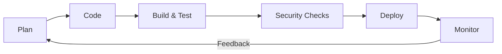

<div align="center">


[](https://git.io/typing-svg)

[](https://zeeshan-sand.vercel.app/)
[](https://github.com/zeeshanizm)


</div>

## 👨‍💻 About Me

I'm **Zeeshan Ahmad**, a DevOps Engineer and IT Infrastructure Consultant based in Gurugram, India. I focus on designing reliable cloud infrastructure, streamlining delivery pipelines, automating repetitive operations, and improving system observability.

```yaml
name: Zeeshan Ahmad
role: DevOps Engineer | IT Infrastructure Consultant
location: Gurugram, India
focus:
  - Cloud architecture and infrastructure automation
  - CI/CD and release engineering
  - Container orchestration and infrastructure as code
  - Monitoring, reliability and incident response
principle: "Build • Automate • Deploy • Scale • Secure • Optimize"
```

## ⚡ Engineering Highlights

<div align="center">

| 99.98% | 75% | 40% | 100+ |
|:---:|:---:|:---:|:---:|
| Uptime achieved | Faster deployments | Infrastructure cost reduction | Microservices supported |

</div>

*Selected career highlights; see my portfolio for more context.*

## 🛠️ Technology Stack

<div align="center">

**Cloud & Infrastructure**


**CI/CD & Containers**


**Operations & Reliability**


</div>

## 🔁 My Delivery Workflow



## 🚀 Explore My Work

<div align="center">

<a href="https://zeeshan-sand.vercel.app/"></a>
<a href="https://github.com/zeeshanizm?tab=repositories"></a>

</div>

## 📊 GitHub Activity

<div align="center">


</div>

## 🐍 Contribution Animation

<div align="center">


</div>

> The snake animation requires the included GitHub Actions workflow to be added and run once. If you only upload this README, remove this section until the workflow is configured.

## 🤝 Let's Connect

Interested in cloud engineering, infrastructure automation, system reliability, or collaboration? Explore my work and connect through the contact options on my portfolio.

<div align="center">

[](https://zeeshan-sand.vercel.app/)
[](https://github.com/zeeshanizm)


</div>

## 🐍 My Contribution Activity


